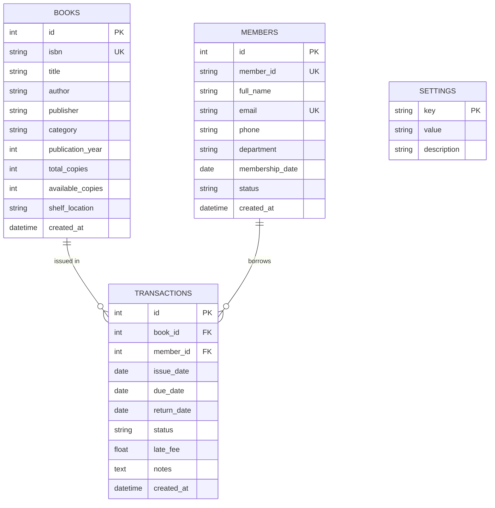

# 📚 Auspify LMS - Enterprise Library Management System

> **Auspify Technologies Software Development Internship Project**  
> A full-stack, enterprise-grade Library Management System designed to administer books, members, circulation lifecycles (issuing and returning), automated overdue fine calculations, interactive business intelligence analytics, and audit reports with CSV export.

---

## 🌟 System Highlights & Features

### 1. 📊 Executive Dashboard
- **Real-Time Circulation Counters:**
  - **Total Books:** Total count of physical volumes across all catalog items.
  - **Available Books:** Live count of copies immediately available on shelves.
  - **Issued Books:** Currently active loans borrowed by patrons.
  - **Total Members:** Registered students and faculty members.
  - **Overdue Books:** Active loans past their designated due date requiring follow-up.
  - **Books Returned Today:** Check-in desk throughput counter for the current date.
- **Visual Analytics:**
  - **Monthly Circulation Trends:** Interactive `Recharts` bar chart showing monthly issue vs. return volume across 6 months.
  - **Collection by Category:** Donut/Pie distribution of catalog holdings across academic disciplines.
  - **Most Borrowed Books:** Ranked leaderboard of the most popular titles.
  - **Recent Transactions Ledger:** Real-time stream of latest circulation events with one-click return actions.

### 2. 📖 Book Catalog & Inventory Management
- **Full CRUD Support:** Add, edit, inspect, and remove book titles.
- **Detailed Metadata:**
  - Book ID & Unique ISBN (indexed and validated)
  - Title, Author, Publisher, and Publication Year
  - Academic Category (Computer Science, AI, Web Dev, Mathematics, etc.)
  - Total Copies, Available Copies (with visual stock percentage meters)
  - Physical Shelf Location (e.g., `Rack SE-101`, `Rack CS-201`)
- **Instant Search & Multi-Filter:**
  - Real-time search across title, author, ISBN, and publisher.
  - Filter by category and stock availability (*Available in Stock* vs. *Fully Issued*).
- **Referential Integrity Protection:** Deletion is blocked if any physical copies are currently checked out to patrons.

### 3. 👥 Member Directory & Patron Profiles
- **Full CRUD Support:** Enroll, update, delete, and view patron profiles.
- **Comprehensive Member Details:**
  - Unique Member ID (e.g., `AUSP-2026-001`)
  - Full Name, Validated Email Address, Phone Number
  - Academic Department (CSE, AI & DS, IT, Business Analytics, etc.)
  - Enrollment Date & Membership Status (*Active*, *Inactive*, *Suspended*)
- **Patron History Modal:** Detailed profile drawer exhibiting total borrowed volumes, current active loans, and complete historical audit ledger.
- **Circulation Safeguards:** Prevents member deletion if unreturned books exist.

### 4. 📤 Book Issue Module (Circulation Checkout)
- **Interactive Patron Picker:** Searchable member selector validating patron status (*Active* members only).
- **Available Stock Picker:** Fast book search displaying real-time available copy counts (blocks books with 0 available copies).
- **Automated Due Date Calculation:**
  - Default borrowing period of **14 days** (configurable in System Settings).
  - Dynamic due date preview calculated live as borrow period slider is adjusted.
- **Inventory Synchronization:** Decrements available copy count immediately upon confirmation; prevents negative stock.

### 5. 📥 Book Return Console (Circulation Check-in)
- **Active Loan Search:** Instant lookup by book title, ISBN, member name, or patron ID.
- **Overdue Loan Flagging:** Immediate visual alert for overdue materials.
- **Automated Late Fine Calculation:**
  - Automated calculation of overdue days: `overdue_days = return_date - due_date`.
  - Configurable late fine of **₹5.00 per overdue day**.
  - Dynamic preview of total fine before finalizing return.
- **Stock Restoration:** Increments physical available copies upon check-in; updates transaction record to *Returned*.

### 6. 🧾 Transaction Management & Audit Ledger
- **Master Circulation Ledger:**
  - Transaction ID
  - Book Title & ISBN
  - Member Name & Member ID
  - Issue Date & Scheduled Due Date
  - Actual Return Date & Settlement Status (*Issued*, *Overdue*, *Returned*)
  - Assessed Late Fines
- **Filter Tabs:** Quickly isolate *All Records*, *Issued (Active)*, *Overdue*, or *Returned*.

### 7. 📑 Report Generation & CSV Export
Provides 6 standardized business intelligence reports with immediate tabular preview and one-click streaming CSV file download:
1. **Total Books Inventory Report:** Complete catalog audit of holdings and shelf racks.
2. **Available Books in Stock Report:** Titles ready for circulation.
3. **Currently Issued Books Report:** Active loans with borrower details.
4. **Overdue Books & Late Fines Report:** Past-due materials and outstanding fines.
5. **Member Activity & Fines Report:** Patron checkout frequency and historical fines paid.
6. **Monthly Circulation Master Log:** Historical circulation ledger.

### 8. ⚙️ System Preferences & Policy Configuration
- Configurable **Late Fee per Overdue Day** (default: `₹5.00`).
- Configurable **Default Borrowing Period** (default: `14 days`).
- Configurable **Maximum Books per Member** (default: `5`).
- Configurable **Library Branding Name** and **Currency Symbol** (`₹`).
- Live diagnostics panel showing runtime environment and architecture specs.

---

## 🛠️ Technology Stack

| Layer | Technologies Used |
|---|---|
| **Frontend Framework** | **React 19** with **TypeScript** |
| **Build Tool & Bundler** | **Vite 8.3** |
| **Styling & Design System** | **Tailwind CSS v4** (`@tailwindcss/vite`) |
| **Icons & Visuals** | **Lucide React** |
| **Data Visualization** | **Recharts 3.10** (Responsive Bar, Area, & Pie charts) |
| **HTTP Client** | **Axios 1.21** (with Vite dev server proxy) |
| **Backend Framework** | **Python 3.10+ FastAPI** (High-performance ASGI) |
| **ASGI Server** | **Uvicorn** (Standard with uvloop and httptools) |
| **ORM & Relational DB** | **SQLAlchemy 2.0** + **SQLite 3** (`library.db`) |
| **Data Validation** | **Pydantic v2** (`ConfigDict`, `EmailStr`, Field constraints) |
| **Testing Suite** | **Pytest 8.3** + `fastapi.testclient.TestClient` |

---

## 🗄️ Database Architecture & Normalization

The SQLite database (`backend/library.db`) implements clean Third Normal Form (3NF) relational tables with foreign keys and cascade options:



### Business Logic Rules
- **Non-Negative Inventory:** `available_copies` cannot drop below `0`.
- **Integrity Bounds:** `available_copies` cannot exceed `total_copies`.
- **Loan Capacity Limit:** Members cannot borrow more than `max_books_per_member` active titles concurrently.
- **Active Patron Verification:** Only members with status `Active` can borrow materials.
- **Late Fee Formula:** `late_fee = max(0, (return_date - due_date).days) * late_fee_per_day`.

---

## 🔌 RESTful API Reference

The backend provides complete OpenAPI / Swagger documentation accessible at `http://127.0.0.1:8000/api/docs`.

### Books API (`/api/books`)
| Method | Endpoint | Description |
|---|---|---|
| `GET` | `/api/books` | List books with search, category filter, availability, pagination |
| `GET` | `/api/books/{id}` | Retrieve single book details |
| `POST` | `/api/books` | Create a new book title (unique ISBN enforced) |
| `PUT` | `/api/books/{id}` | Update book details and copy counts |
| `DELETE` | `/api/books/{id}` | Delete book (blocked if copies are currently issued) |

### Members API (`/api/members`)
| Method | Endpoint | Description |
|---|---|---|
| `GET` | `/api/members` | List members with search, department, and status filters |
| `GET` | `/api/members/{id}` | Retrieve member profile |
| `GET` | `/api/members/{id}/history` | Retrieve member profile and complete borrowing history |
| `POST` | `/api/members` | Register new member (unique ID and email enforced) |
| `PUT` | `/api/members/{id}` | Update member profile |
| `DELETE` | `/api/members/{id}` | Delete member (blocked if unreturned books exist) |

### Transactions API (`/api/transactions`)
| Method | Endpoint | Description |
|---|---|---|
| `POST` | `/api/transactions/issue` | Issue book to member (calculates due date, reduces stock) |
| `POST` | `/api/transactions/return` | Check in book (calculates overdue days & late fee, restores stock) |
| `GET` | `/api/transactions` | List all transactions with status filters and search |
| `GET` | `/api/transactions/{id}` | Get single transaction detail |
| `GET` | `/api/transactions/dashboard-stats` | Comprehensive circulation metrics, monthly trends, and charts |

### Reports API (`/api/reports`)
| Method | Endpoint | Description |
|---|---|---|
| `GET` | `/api/reports?type={report_type}` | Fetch structured JSON report data |
| `GET` | `/api/reports/export/csv?type={type}` | Stream downloadable CSV report file |

### Settings API (`/api/settings`)
| Method | Endpoint | Description |
|---|---|---|
| `GET` | `/api/settings` | Retrieve active circulation rules and parameters |
| `PUT` | `/api/settings` | Update late fee rate, borrow period, library identity |

### Health Check
| Method | Endpoint | Description |
|---|---|---|
| `GET` | `/api/health` | Service health status and metadata |

---

## 🚀 Getting Started & Installation

### Prerequisites
- **Python 3.10+**
- **Node.js v18+** & **npm v9+**

### 1. Repository Clone & Structure
```bash
git clone <repository_url>
cd LMS
```

### 2. Backend Setup
```bash
# Navigate to backend directory
cd backend

# Create virtual environment (if not already created)
python -m venv venv

# Activate virtual environment
# Windows (PowerShell):
.\venv\Scripts\Activate.ps1
# Windows (cmd):
.\venv\Scripts\activate.bat
# Linux/macOS:
source venv/bin/activate

# Install dependencies
pip install -r requirements.txt

# Run the FastAPI server
uvicorn app.main:app --host 127.0.0.1 --port 8000 --reload
```
> **Note:** On initial startup, the backend automatically seeds realistic sample books, members, and active/overdue circulation records into `library.db`.

### 3. Frontend Setup
In a new terminal:
```bash
# Navigate to frontend directory
cd frontend

# Install npm packages
npm install

# Start Vite development server
npm run dev
```

Open your browser at:
👉 **`http://127.0.0.1:5173/`**

---

## 🧪 Running Automated Tests

The backend includes a comprehensive Pytest test suite covering health checks, book and member CRUD operations, stock constraints, automated overdue fine assessments, and report generation:

```bash
cd backend
.\venv\Scripts\python -m pytest -v tests/test_api.py
```

Sample output:
```text
tests/test_api.py::test_health_check PASSED                              [ 20%]
tests/test_api.py::test_book_crud_and_stock PASSED                       [ 40%]
tests/test_api.py::test_member_crud PASSED                               [ 60%]
tests/test_api.py::test_issue_and_return_cycle_and_late_fees PASSED      [ 80%]
tests/test_api.py::test_reports_and_csv_export PASSED                    [100%]
============================== 5 passed in 1.57s ===============================
```

To build and validate the frontend production bundle:
```bash
cd frontend
npm run build
```

---

## 📁 Project Directory Structure

```
d:/LMS/
├── backend/
│   ├── app/
│   │   ├── __init__.py
│   │   ├── main.py            # FastAPI app initialization, CORS, lifespan
│   │   ├── database.py        # SQLAlchemy engine, session maker, get_db
│   │   ├── models.py          # Book, Member, Transaction, Setting models
│   │   ├── schemas.py         # Pydantic v2 schemas for requests & responses
│   │   ├── crud.py            # Business logic, circulation, fine calculators
│   │   ├── seed_data.py       # Sample catalog, patrons & loan records
│   │   └── routers/
│   │       ├── books.py        # /api/books CRUD endpoints
│   │       ├── members.py      # /api/members CRUD endpoints
│   │       ├── transactions.py # /api/transactions circulation endpoints
│   │       ├── reports.py      # /api/reports JSON & CSV export
│   │       └── settings.py     # /api/settings configuration endpoints
│   ├── tests/
│   │   └── test_api.py        # Pytest test suite
│   ├── requirements.txt       # Python dependencies
│   └── library.db             # SQLite database file
├── frontend/
│   ├── src/
│   │   ├── components/
│   │   │   ├── Sidebar.tsx         # Navigation sidebar with live badges
│   │   │   ├── Header.tsx          # Dynamic top bar with quick actions
│   │   │   ├── Dashboard.tsx       # Stat cards, Recharts trends & lists
│   │   │   ├── BookManagement.tsx  # Catalog CRUD, search & filters
│   │   │   ├── MemberManagement.tsx# Patron CRUD & borrowing history
│   │   │   ├── IssueBook.tsx       # Circulation checkout console
│   │   │   ├── ReturnBook.tsx      # Return desk & dynamic fine assessor
│   │   │   ├── Transactions.tsx    # Master audit ledger
│   │   │   ├── Reports.tsx         # 6 analytics reports & CSV exporter
│   │   │   ├── Settings.tsx        # System policies & architecture view
│   │   │   └── NotificationToast.tsx # Toast alerts
│   │   ├── services/
│   │   │   └── api.ts              # Axios HTTP client with typed methods
│   │   ├── types.ts                # TypeScript data interfaces
│   │   ├── App.tsx                 # Root application state & router
│   │   ├── main.tsx                # React root mount
│   │   └── index.css               # Tailwind CSS v4 styling & theme
│   ├── index.html                  # HTML entry with Inter font
│   ├── vite.config.ts              # Vite configuration with proxy to port 8000
│   ├── tsconfig.json               # TypeScript configuration
│   └── package.json                # Frontend package dependencies
└── README.md                       # Complete project documentation
```

---

## 👨‍💻 Auspify Technologies Internship Information

- **Project:** Library Management System
- **Role:** Software Development Intern
- **Organization:** Auspify Technologies
- **Status:** Verified, Tested, and Production-Ready

---
*Developed with modern software craftsmanship standards: robust error handling, normalized database constraints, responsive UI aesthetics, and end-to-end automated testing.*
